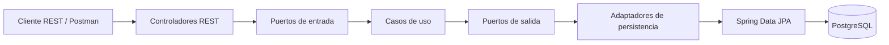

# Arquitectura hexagonal - Tienda

## Organización

- `domain/model`: modelos compartidos del negocio (Pedido, Producto, DetallePedido, EstadoPedido y Usuario).
- `domain/port/in`: contratos de los casos de uso que consume la API.
- `domain/port/out`: contratos de persistencia requeridos por los casos de uso.
- `application/usecase`: servicios de aplicación (PedidoService, ProductoService y UsuarioService).
- `infrastructure/adapter/input/rest`: controladores REST.
- `infrastructure/adapter/output`: adaptadores que implementan los puertos de salida.
- `infrastructure/persistence/repository`: interfaces Spring Data JPA.
- `infrastructure/exception`: manejo de errores HTTP.

## Flujo



## Endpoints

### Usuarios

- `POST /api/usuarios` - registrar usuario.
- `GET /api/usuarios` - listar usuarios.
- `GET /api/usuarios/{id}` - consultar usuario.
- `PUT /api/usuarios/{id}` - actualizar usuario.
- `DELETE /api/usuarios/{id}` - eliminar usuario.

Ejemplo de cuerpo para crear/actualizar:

```json
{
  "nombre": "Ana Pérez",
  "email": "ana@example.com",
  "telefono": "3001234567"
}
```

### Productos

- `POST /api/productos`
- `GET /api/productos`
- `GET /api/productos/{id}`
- `PUT /api/productos/{id}`
- `DELETE /api/productos/{id}`

### Pedidos

- `POST /api/pedidos`
- `GET /api/pedidos`
- `GET /api/pedidos/{id}`
- `PUT /api/pedidos/{id}`
- `POST /api/pedidos/{id}/items?productoId=1&cantidad=2`
- `DELETE /api/pedidos/{id}/items/{itemId}`
- `PATCH /api/pedidos/{id}/confirmar`
- `PATCH /api/pedidos/{id}/cancelar`
- `DELETE /api/pedidos/{id}`

## Configuración

La aplicación conserva PostgreSQL y el puerto 8001. Configura `DB_URL`, `DB_USERNAME` y `DB_PASSWORD` como variables de entorno o ajusta `application.properties` para tu entorno local.

## Ejecución

Desde la raíz del proyecto:

```bash
mvn clean test
mvn spring-boot:run
```

## Nota técnica para la sustentación

Esta reorganización introduce puertos de entrada/salida y adaptadores, y hace que los servicios de pedidos y productos dependan de interfaces de salida en lugar de inyectar directamente los repositorios Spring Data. Para una separación estricta adicional, las entidades JPA actuales (`Pedido`, `Producto` y `DetallePedido`) deben separarse en entidades de persistencia y modelos de dominio puros con mapeadores explícitos. En esta entrega se conservan como modelos compartidos para minimizar el riesgo de alterar el comportamiento de inventario, totales y relaciones ya existente.
